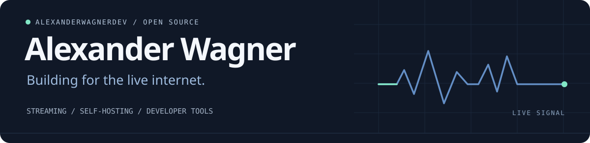

[Website](https://alexanderwagnerdev.com) &nbsp;·&nbsp; [OpenRTMP](https://openrtmp.org/) &nbsp;·&nbsp; [IRL.com.de](https://irl.com.de) &nbsp;·&nbsp; [Docker Hub](https://hub.docker.com/u/alexanderwagnerdev) &nbsp;·&nbsp; [Email](mailto:info@alexanderwagnerdev.com)

## 👋 About me

I'm a hobby developer who loves building things, especially when streaming, networking and self-hosting come together.

- 🎥 Making live and IRL streaming smoother, faster and more reliable
- 🦀 Building modern RTMP infrastructure with [OpenRTMP](https://github.com/OpenRTMP)
- 🐧 Running my own infrastructure and automating the boring parts
- 🤖 Exploring self-hosted AI developer tools and coding agents
- 🛠️ Learning by building real projects and sharing what works

## 🚀 Currently building

### [OpenRTMP](https://github.com/OpenRTMP)

Modern, open-source RTMP infrastructure — from protocol implementation to complete, self-hosted deployments.

- 🦀 **[librtmp2](https://github.com/OpenRTMP/librtmp2)** — Rust RTMP/RTMPS library with Enhanced RTMP, AMF, relay primitives and C-compatible FFI.
- 📡 **[librtmp2-server](https://github.com/OpenRTMP/librtmp2-server)** — Streaming server with stream management, REST API and real-time statistics.
- 🎛️ **[librtmp2-server-panel](https://github.com/OpenRTMP/librtmp2-server-panel)** — Web interface to manage and monitor streams.
- 📦 **[packages](https://github.com/OpenRTMP/packages)** · **[homebrew-tap](https://github.com/OpenRTMP/homebrew-tap)** — Build and distribution infrastructure.
- 🌐 **[openrtmp.org](https://github.com/OpenRTMP/openrtmp.org)** · **[community](https://github.com/OpenRTMP/community)** — Website, documentation and community hub.

[Website & docs](https://openrtmp.org/) · [Packages](https://packages.openrtmp.org/) · [crates.io](https://crates.io/crates/librtmp2) · [Discussions](https://github.com/OpenRTMP/community/discussions)

### [IRL.com.de](https://irl.com.de)

A free streaming relay service for IRL creators. Bringing RTMP, SRT and real-world streaming workflows together.

### [AgentNexus](https://github.com/AlexanderWagnerDev/agent-nexus)

One self-hosted hub for AI coding agents. Discover, manage and continue existing OpenCode, Codex CLI and Claude Code sessions across Windows, Linux and macOS.

[Repository](https://github.com/AlexanderWagnerDev/agent-nexus) · [Releases](https://github.com/AlexanderWagnerDev/agent-nexus/releases)

### [FFmpeg for Ubuntu](https://github.com/AlexanderWagnerDev/ffmpeg-ubuntu)

Automated, community-maintained packages for stable FFmpeg releases, distributed via a Launchpad PPA and a signed APT repository.

[Repository](https://github.com/AlexanderWagnerDev/ffmpeg-ubuntu) · [Launchpad PPA](https://launchpad.net/~alexanderwagnerdev/+archive/ubuntu/ffmpeg) · [APT repository](https://alexanderwagnerdev.github.io/ffmpeg-ubuntu/)

## 🎥 Streaming & self-hosting

- 🚀 **[stream-relay-installer](https://github.com/AlexanderWagnerDev/stream-relay-installer)** — Interactive installer for a self-hosted RTMP, SRT and SRTLA streaming stack.
- 📡 **[rtmp-server-docker](https://github.com/AlexanderWagnerDev/rtmp-server-docker)** — OpenRTMP streaming server packaged for Docker.
- 🎛️ **[rtmppanel-docker](https://github.com/AlexanderWagnerDev/rtmppanel-docker)** — Docker distribution of the OpenRTMP control panel.
- 📶 **[srtla-server-docker](https://github.com/AlexanderWagnerDev/srtla-server-docker)** — Low-latency SRTLA and SRT-Live-Server infrastructure.
- 🎛️ **[slspanel-docker](https://github.com/AlexanderWagnerDev/slspanel-docker)** — Web control panel for SRT-Live-Server.
- 🔄 **[noalbs-docker](https://github.com/AlexanderWagnerDev/noalbs-docker)** · **[noalbs-linux](https://github.com/AlexanderWagnerDev/noalbs-linux)** — Automatic OBS scene switching based on stream health.
- 🎬 **[obs-docker](https://github.com/AlexanderWagnerDev/obs-docker)** · **[stream-server-bitrate](https://github.com/AlexanderWagnerDev/stream-server-bitrate)** — Containerized OBS and bitrate monitoring tools.

## ⚙️ Infrastructure & automation

- 🔍 **[virustotal-domains-scan](https://github.com/AlexanderWagnerDev/virustotal-domains-scan)** — Domain security scanner with web UI, logging and alerts.
- 💾 **[all-inkl-hetzner-backup](https://github.com/AlexanderWagnerDev/all-inkl-hetzner-backup)** — Automated webspace backups via WebDAV.
- 🐧 **[proxmox-rtl-sdr-lxc-auto-fix](https://github.com/AlexanderWagnerDev/proxmox-rtl-sdr-lxc-auto-fix)** — Proxmox LXC troubleshooting and automation for RTL-SDR.

<b>More public projects & related forks</b>

- 📦 Linux container images: [alpine-docker](https://github.com/AlexanderWagnerDev/alpine-docker), [debian-docker](https://github.com/AlexanderWagnerDev/debian-docker), [ubuntu-docker](https://github.com/AlexanderWagnerDev/ubuntu-docker)
- 🌙 Dark mode: [wp-darkadmin-plugin](https://github.com/AlexanderWagnerDev/wp-darkadmin-plugin), [keyhelp-dark-mode](https://github.com/AlexanderWagnerDev/keyhelp-dark-mode)
- 🔀 Upstream forks: [openirl-srt](https://github.com/AlexanderWagnerDev/openirl-srt), [BitrateSceneSwitch](https://github.com/OpenRTMP/BitrateSceneSwitch), [awesome-self-hosted-first-streaming](https://github.com/OpenRTMP/awesome-self-hosted-first-streaming)

## 🧰 Tech stack

**Languages**

**Infrastructure & media**

`RTMP` · `RTMPS` · `Enhanced RTMP` · `SRT` · `SRTLA` · `Networking` · `CI/CD`

---

## 🤝 Get in touch

Have an idea, found a bug or want to improve something? Feel free to open an issue or pull request in the relevant repository.

🌐 [alexanderwagnerdev.com](https://alexanderwagnerdev.com) &nbsp;·&nbsp; 📬 [info@alexanderwagnerdev.com](mailto:info@alexanderwagnerdev.com)
